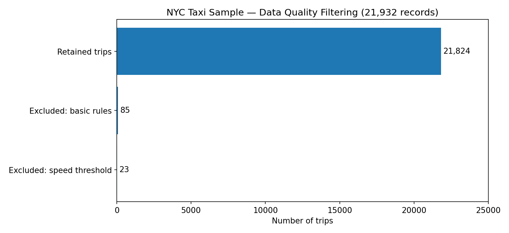

# NYC Taxi Trip Quality & Fare Anomaly Analysis

**SQL | Databricks | Data Quality | Exploratory Anomaly Detection**

This portfolio project examines trip quality, implied travel speeds, and unusual fares in Databricks' public sample NYC taxi trips. It began as a personal extension of data engineering/SQL coursework. The aim is to demonstrate a defensible analytical workflow—not to claim to detect proven fraud.

## Key results

| Measure | Result |
|---|---:|
| Original taxi trips | 21,932 |
| Trips after initial positive-distance/fare/duration rules | 21,847 |
| Trips above exploratory 100 mph speed threshold | 23 |
| Trips retained after both filtering stages | 21,824 (99.51%) |
| Records excluded across stages | 108 |
| Mean distance of retained trips | 2.86 miles |
| Mean fare of retained trips | $12.31 |
| Mean implied speed of retained trips | 11.98 mph |
| Exact $52 fares in retained data | 402 |

**Interpretation:** Basic positivity checks missed 23 trips with calculated travel speeds above 100 mph, including implausible speeds above 10,000 mph. These suggest timestamps or distance-recording problems; they are not evidence of intentional fraud. A repeated $52 fare can reflect a legitimate pricing structure, illustrating why a high fare-per-mile ratio alone is not a fraud label.

## Questions explored

1. Are pickup/drop-off timestamps, distances, and fares missing or invalid?
2. What changes when we exclude nonpositive distances/fares/durations?
3. Do positive-valued trips still include implausible implied speeds?
4. Which fares appear unusual relative to distance, and how do we contextualize repeated amounts?

## Method

- Profile missing and nonpositive values with `COUNT`, `SUM`, and `CASE`.
- Preserve the original dataset; apply filters in queries instead of overwriting records.
- Calculate trip duration and implied average miles per hour using timestamp differences.
- Use **100 mph as an exploratory review threshold**, not a validated production rule.
- Evaluate fare per mile for trips at least one mile long to reduce the smallest-distance denominator effect.
- Investigate repeated 52-dollar fares and discuss potential fixed-rate explanations without claiming knowledge of the individual routes.

## Files

- [`notebooks/NYC_Taxi_Analysis.ipynb`](notebooks/NYC_Taxi_Analysis.ipynb): SQL queries, saved Databricks result tables, and written interpretations.
- [`figures/data_quality_overview.png`](figures/data_quality_overview.png): Visualization of the two stages of filtering.

## How to reproduce

1. Sign in to a Databricks workspace with access to `samples.nyctaxi.trips`.
2. Import the notebook under `notebooks/` (the queries use Databricks `%sql` cell magic).
3. Attach available compute and execute its cells in order.
4. Compare results with the recorded outputs; the dataset may change if sample data is updated.

### Limitations

- A source table's historical taxi data and fare fields alone cannot establish fraud.
- The 100 mph filter and one-mile fare-per-mile cutoff are heuristic analysis decisions rather than calibrated classifiers.
- Counts for individual quality checks overlap, and a strict positive-fare rule may exclude legitimate reversals/refunds.
- Output is a sample analysis, not necessarily representative of all NYC trips or current pricing.
- No personal passenger information, secret tokens, or proprietary game data are included.

## Skills demonstrated

Databricks SQL · `CASE WHEN` · `GROUP BY` · CTEs · filtering · data validation · summary statistics · anomaly investigation · communication of limitations
